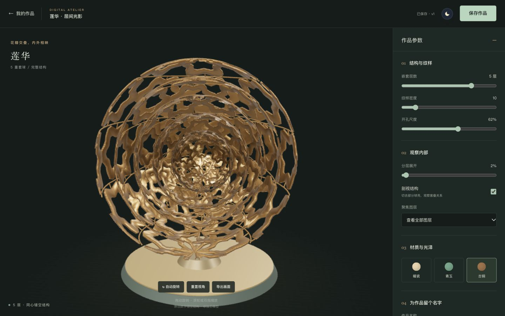
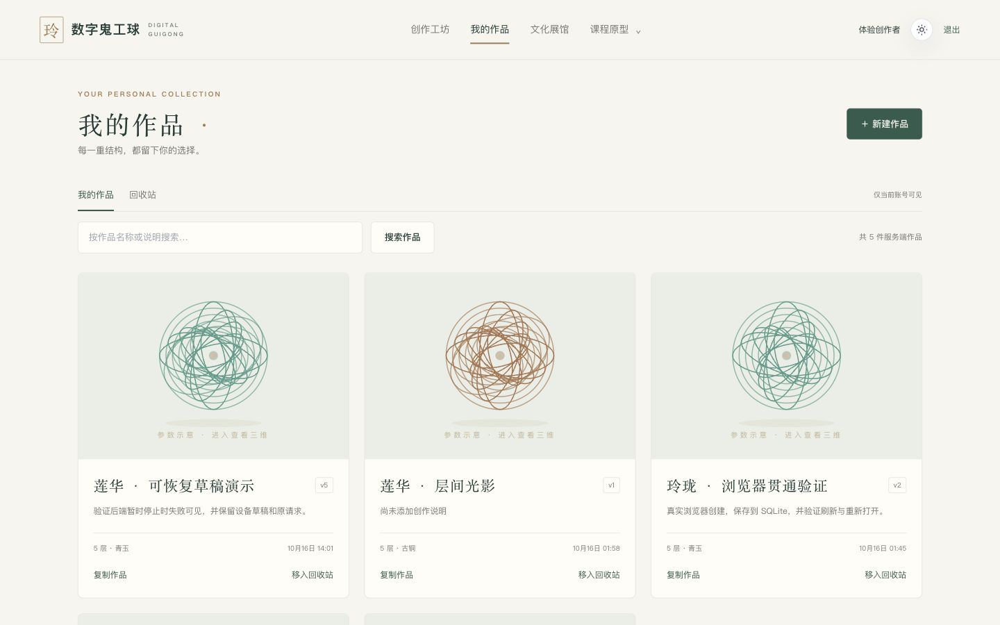
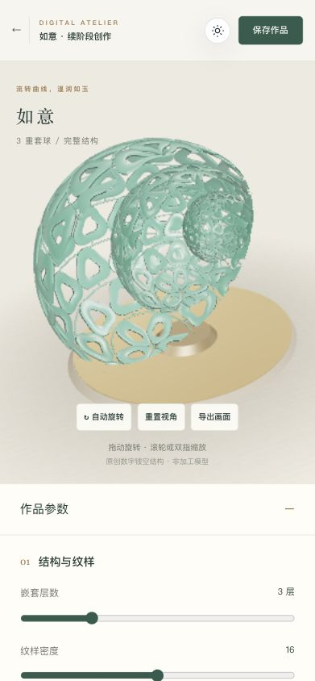
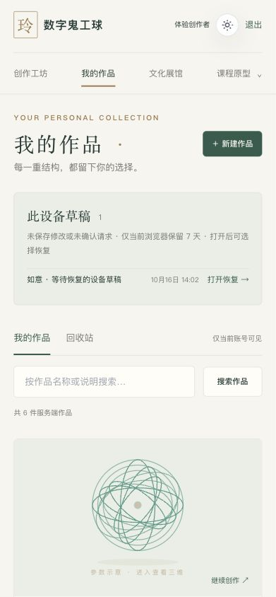

# 数字鬼工球 · Digital Guigong Ball

以岭南鬼工球文化为背景的三维创作工坊。由课程前端原型升级为本地可运行的全栈作品：**注册/登录 → 选择模板 → 调整三维结构 → 保存到 SQLite → 列表检索 → 重新打开并继续修改**。



## 现在可以做什么

- 三种原创参数化纹样、2–6 层独立嵌套球壳；真实几何镂空，支持密度、开孔尺度、暖瓷/青玉/古铜材质、展开、剖视和图层聚焦。
- 鼠标或触摸旋转、缩放；PNG 画面与 JSON 配置下载。配置保存后可复现结构，暂不保存自由相机视角。
- 真实账号、服务端会话与个人作品；标题/说明搜索与分页、复制、回收站恢复、版本冲突保护。刷新、退出重登、后端重启后仍可读取。
- 请求键与数据库事务避免同一请求重试时重复创建/更新；未确认请求可在同账号重新登录后继续确认。设备草稿单独标注、显式恢复，不冒充正式保存。
- 一致性数据库快照与恢复到新文件的维护命令；恢复撤销旧会话。
- 原课程文化展馆与原型功能保留，导航中明确区分真实创作与模拟业务。

这是数字观赏与结构探索系统，纹样是原创数字风格化表达，不是传统实物的精确复原或加工级雕刻。没有使用真实象牙材料。

## 运行（推荐演示方式）

需要 **Node.js ≥22.13**、npm 和支持 WebGL 的现代浏览器。已验证 Node 22.13.1 与本地 Node 26.4；Node 22 的内置 SQLite 可能输出实验性 API 提示。无需云账号、外部密钥或付费服务。

```bash
git clone https://github.com/meilingrl/DigitalGuiGongBall.git
cd DigitalGuiGongBall
git switch upgrade/fullstack-atelier-20261016
npm ci
npm run db:init
npm run db:seed
npm run build:all
npm start
```

打开 **http://127.0.0.1:3001**。`npm start` 同时提供前端静态文件和 `/api`；从仓库根目录执行。用 `Ctrl+C` 停止。

- `db:init` 可重复执行，普通启动也会初始化空库并应用已知迁移（当前 v2），不创建账号。已有 v1 作品与密码保留；升级前可用下方命令备份。
- `db:seed` 显式创建公开本地体验账号 **`demo` / `Guigong2026!`** 及两件示范作品。也可直接在页面注册。
- 重复种子操作不会覆盖已修改作品或已有账号密码；若 `demo` 原已存在，终端会提示沿用原密码。
- 数据默认在 `data/guigong.sqlite`，已被 Git 忽略。此文件与 `.env` 不应提交；切换数据库路径会得到另一套账号和作品。

开发时开两个终端，分别执行：

```bash
npm run dev:api  # 后端 http://127.0.0.1:3001
npm run dev     # 前端 http://127.0.0.1:5173，/api 代理到后端
```

开发与演示都使用同一个默认数据库。若 5173 被占用，应释放端口后重试，或同时设置 Vite 端口和允许的 Origin；不要忽略服务地址变化。

## 配置

默认配置即可运行；需要调整时，复制 `.env.example` 为 `.env`，修改占位配置：

| 变量 | 默认值 / 用途 |
| --- | --- |
| `HOST` / `PORT` | `127.0.0.1` / `3001`，仅本机访问 |
| `DATABASE_PATH` | `./data/guigong.sqlite`，相对于仓库根目录 |
| `ALLOWED_ORIGINS` | 本地 5173/3001 的精确 Origin，逗号分隔，无末尾斜杠 |
| `SESSION_TTL_HOURS` | `168`，服务端会话有效期 |
| `SECURE_COOKIES` | 本地 HTTP 用 `false`；HTTPS 才使用 `true` |
| `VITE_AMAP_KEY`（可选） | 仅历史探访模块需要；缺失时地图显示降级提示，创作流程正常 |

API 写请求必须携带允许的 `Origin`。浏览器自动携带；自行用 curl/HTTP 工具时需添加，例如 `Origin: http://127.0.0.1:3001`。没有跨域开放 CORS。前端开发代理目标固定为 3001，修改 API 端口时同步修改 `vite.config.ts`。

## 3–5 分钟演示路线

1. 登录 `demo`，打开「创作工坊」，选择「如意」或「莲华」。
2. 拖动旋转、滚轮缩放；调整层数、纹样密度与材质，展开球壳，开启剖视，切换聚焦层。
3. 填写作品名和说明，点击「保存作品」，确认显示「已保存」与版本号。
4. 返回「我的作品」，搜索作品名并重新打开；刷新，检查结构、材质和观察参数恢复。
5. 修改一个参数再保存，确认版本递增；退出、重新登录，检查作品仍存在。
6. 返回列表，复制该作品；将副本移入「回收站」再恢复，打开检查结构保留、版本递增。
7. 可选：改动后不保存，重新打开同一作品并选择「恢复此设备草稿」，再正式保存。停止服务后 `npm start`，数据仍在；注册第二账号，其列表应为空。



草稿与服务端作品单独展示：

移动端布局也已在约 391×844 CSS 视口检查：

 

## 架构与接口

`Vue 3 / Pinia / Vue Router → 同源 Express 5 API → SQLite 文件`；Three.js 在浏览器根据共享配置生成结构。运行时 Zod 校验放在 `shared/design.ts`，配置带 `schemaVersion`。

- `src/views/AtelierView.vue` 与 `src/composables/`：页面、文档与列表生命周期分别管理；正式保存、未确认请求重试、显式草稿恢复、迟到响应隔离。
- `src/three/`：独立几何生成、取景、渲染器与 GPU 资源释放。
- `server/`：迁移、密码/会话、归属权限、校验、种子和启动；SQL 使用参数绑定。
- `users / sessions / works / mutation_journal / schema_migrations`：作品查询与更新均包含 owner 条件，旧版本写入返回 409。

| API | 行为 |
| --- | --- |
| `GET /api/health`、`GET /api/templates` | 健康检查、公开模板 |
| `POST /api/auth/register`、`POST /api/auth/login` | 建立 HttpOnly / SameSite 会话 |
| `GET /api/auth/me`、`POST /api/auth/logout` | 恢复身份、服务端撤销会话 |
| `GET /api/works?search=&state=active&page=1&pageSize=12`、`POST /api/works` | 本人搜索/分页/状态筛选、创建 |
| `GET /api/works/:id`、`PUT /api/works/:id` | 归属检查、读取与带版本更新 |
| `POST /api/works/:id/duplicate` | `{version,title?}` 复制为独立 v1 |
| `POST /api/works/:id/trash`、`POST /api/works/:id/restore` | `{version}` 可逆状态转换并递增版本 |

密码使用随机盐 scrypt，数据库只存会话令牌摘要；认证请求有基本限流。错误返回有限 JSON 消息，未登录 401、非法输入 400、他人/不存在作品 404、版本冲突 409。回收站不提供永久清空。列表默认每页12件，最大48；回收站用 `state=trash`。

作品写入可携带 UUID `Idempotency-Key`；新 UI 始终携带。新UI还携带 `X-Expected-User-Id`，服务端仅将其与当前会话核对；另一标签切换账号时返回401并保留原意图，不使用该header授予权限。服务端按账号记录方法、路径、规范化载荷摘要和原响应，业务修改与记录在同一事务提交；同一请求重放原响应，键被复用于不同载荷/操作返回409。版本检查仍独立生效。请求记录暂不自动过期。

本机恢复记录按已验证 userId 隔离，保留7天；每账号至多20份编辑草稿、单份16KiB，待确认列表操作单独限4KiB。只存作品/请求配置，不存密码或Cookie。跨设备不可见；浏览器禁用或清空存储时会提示，正式保存依然走API。离开前建议保存到服务端；多标签编辑同件作品由服务端版本冲突保护，本机恢复记录按最后写入保留。

## 数据库备份与恢复

以下命令从仓库根目录执行。备份可在本地服务运行、存在 WAL 时执行，不能只复制正在使用的 `.sqlite` 主文件。目标必须是不存在的新文件，工具会拒绝已有主文件、辅助文件或符号链接路径。

```bash
npm run db:backup -- --to ./backups/demo-snapshot.sqlite
# 可显式选择源：再加 --from ./data/guigong.sqlite
npm run db:restore -- --from ./backups/demo-snapshot.sqlite --to ./data/restored-demo.sqlite
# 先 Ctrl+C 停止当前3001服务，再运行恢复副本；原数据库仍保留
DATABASE_PATH=./data/restored-demo.sqlite npm start
```

命令返回操作、schema版本、文件字节数与SHA-256，不输出账号/作品内容。恢复校验SQLite完整性、外键与已知表结构，迁移已知v1并撤销旧会话；用原密码重新登录。备份包含密码哈希、会话摘要与作品，**未加密**，仅留在私有本地目录（新目录700、文件600），不要上传或提交。默认 `backups/` 和数据库文件均被Git忽略。重复执行时选另一个新文件名。

工具面向可信本地目录，需文件系统支持硬链接；同步快照会消耗IO/CPU。发布前后检查目标与辅助文件，发现竞争会保留外来文件并报错，不能保证抵抗恶意进程持续替换父目录。已做本机备份/恢复与重登测试，未做断电、异地灾备或生产演练。

## 验证

```bash
npm run typecheck
npm test
npm run build:all
npm run test:restart  # 先构建；独立临时库与编译后进程，含正常退出和 SIGKILL 后恢复
npm audit --omit=dev
```

测试包括真实 HTTP/临时 SQLite、迁移、跨账号权限、版本与状态冲突、事务回滚、并发幂等重放、分页、WAL快照与恢复拒绝覆盖、草稿限额/异常、文档异步生命周期、几何射线与资源释放。真实HTTP集成测试在数据库提交后注入响应丢失，重启API并重建编辑器/列表，检查重登后重试不重复写。文档单元测试注入外部网络/存储，不能代替浏览器；桌面主流程与移动视口WebGL/布局另外由代理操作浏览器检查；续阶段移动离开确认后的点击受IAB工具限制，未完成完整移动交互验收。CI 复用上述命令，不运行浏览器或真实移动设备测试。

## 范围与已知限制

- **真实实现**：账号/会话、创建读取更新、复制/回收站/恢复/分页搜索、事务内请求重放、SQLite持久化/本地备份恢复、设备草稿、三维参数、剖视/展开/聚焦、PNG/配置下载。
- **保留的课程演示**：统计、积分、社交、预约、商城及文化投稿等仍含固定/内存/浏览器本地数据；不会用于冒充后端作品保存。
- 三维剖视使用裁切平面，截面未封盖；无真实雕刻 CSG、加工级模型导出、联机协作、云存储或正式部署。
- 三维大包仍有 >500KB 构建提示；最高六层约 38 万三角形的预算不等于低端手机性能承诺。未做设备矩阵或压力测试。
- 本地单进程、单文件数据库方案；有本机快照/恢复测试，尚无生产灾备、邮箱找回、监控和多实例限流。请求重放避免同键重试重复写，不等于跨请求的全局恰好一次；清空浏览器记录、超过7天、超过20份草稿上限而被淘汰或显式舍弃后重新创建，会被视为新操作。
- 本轮生产依赖审计为 0；开发依赖仍有 Tailwind 3 链路告警，详见升级记录。未强行迁移 Tailwind 4。
- 新增纹样、SVG 预览和截图均由本项目代码生成；Three.js `RoomEnvironment` 来自依赖自带 MIT 代码，没有新增下载的第三方模型。原素材及其历史说明完整保留。

[升级与验证记录](docs/UPGRADE_20261016.md) · [项目理解、取舍与简历依据](docs/PROJECT_GUIDE.md) · [原课程 README](docs/COURSE_README.md) · [历史设计文档](docs/README.md)
