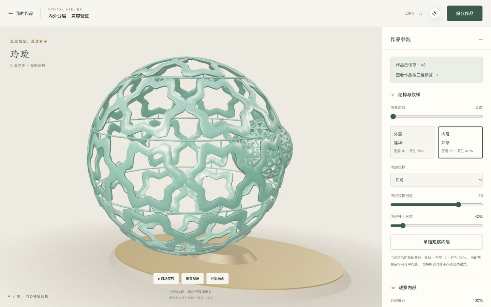

# 内外层参数编辑 · 2026-10-23

> 执行：subagent-driven-development，逐项实现与独立审查；用户已授权具体设计与本轮实现，不重复等待确认。本文合并设计、实施计划和交付记录，保留上一轮历史文档。

**Goal:** 最外层与最内层可独立修改纹样、密度、开孔，真实保存后刷新、重登和重启均完整还原。
**Architecture:** 新增配置 v2 与两个有语义的球壳设置；兼容原样读取/提交 v1。共享层解析函数连接前端、几何和预览，沿用原 API、SQLite JSON 持久化与版本/幂等流程。
**Tech Stack:** Vue 3、TypeScript、Three.js、Express、SQLite、node:test；Node >=22.13，不新增依赖。
**Spec:** 下方「设计与边界」即本轮规格，依据用户 2026-10-23 的逐层编辑授权。

起点 `9508f4f6f6470ef20b5cf60afc3535799c894e18`，开始 2026-10-23 02:17 SGT。复用已隔离工作区 `../DigitalGuiGongBall.worktrees/culture-creation-20261021`，新分支 `upgrade/layer-parameters-20261023`；原目录和上一轮分支保留。

## Global Constraints

- 只实现内外两层的纹样、密度、开孔编辑；不扩展撤销重做、分享、学习系统或其他业务。
- 最外层为 index 0，最内层为 index layers-1；中间层沿用根级模板、密度、开孔。改变层数后角色仍对应新的最外/最内层，不丢弃设置。
- 原配置 v1 的校验输出、请求摘要、pending 请求与 journal 重放不得自动补字段或升级；首次逐层编辑才返回 v2。
- SQLite 仍为 schema v3，无数据库结构迁移或全量重写旧记录；v1/v2 作品在同一服务共存。
- 同一舞台保留一个 WebGLRenderer；离屏预览按已确认配置捕获，借用几何须比较所有有效层纹样，失败恢复和资源所有权不削弱。
- 组件复制配置并发出更新，不修改嵌套 prop；编辑对象不自动改变观察参数，聚焦通过显式操作。
- 不增加运行时/测试依赖，不放宽类型门禁，不删除有效旧协议断言，不模拟后端成功。
- 实现代理不启动其他代理、不推送；主代理负责审查、浏览器验证、正常推送并核对远端。保留原始历史，不合并默认分支、不强推。

## 设计与边界

三种可能：逐层数组适合全部图层编辑，但带来增删层和迁移规则；无版本的可选字段会混淆旧请求与新语义；本轮选有版本的内外角色对象，界面和数据都限定为两层。未来如扩展任意层，再设计下一版格式。

v2 保留现有根级字段，新增必填且严格的 `layerPatterns: { outer, inner }`，每项为 `{ templateId, patternScale, aperture }`。纹样仍用 `linglong | ruyi | lianhua`，密度整数 8–24，开孔 0.35–0.8；仅纹样选择复用三种现有几何，整体模板、材料与来源不随之更换。旧模板默认 v1，首次改某一层时从原值完整初始化两层后只更改目标层。

共享代码职责：`layerPattern.ts` 定义球壳 schema/type；`design.ts` 定义 v1/v2 配置及旧类型导出；`layerDesign.ts` 只解析有效层参数和复制更新，不依赖页面或 Three。`getLayerPattern(config,index)` 返回独立的三字段值；`withLayerPattern(config,role,patch)` 返回 v2，独立复制两个角色，保持材料、观察和中间层默认值。

工坊中保留层数、观察和材料控件，新增「外层 / 内层」选择及纹样、密度、开孔，标明中间层规则；旧全局密度/开孔控件被替换，避免误以为仍修改全部球壳。提供「单独观察此层」显式调用既有聚焦能力，仍可用原下拉查看全部。详情分别列出两层设置，v1 仍显示原全局摘要。

## Task 1: 配置契约与真实持久化兼容

**Files:** 新增 `shared/layerPattern.ts`、`shared/layerDesign.ts`、`tests/layer-design.test.ts`、`server/tests/layer-design.test.ts`；修改 `shared/design.ts`、`scripts/verify-restart.mjs`；确需时补充 `tests/draft.test.ts` / `tests/draft-storage.test.ts`。
**Interfaces:** `LayerRole = 'outer' | 'inner'`；`LayerPattern` 三字段；`getLayerPattern(config: DesignConfig,index:number): LayerPattern`；`withLayerPattern(config: DesignConfig,role:LayerRole,patch:Partial<LayerPattern>): DesignConfigV2`。从 design 导出 `DesignConfigV1`、`DesignConfigV2`、union `DesignConfig`；默认模板明确为 v1。版本化严格对象保持 v1 字段顺序和输出，不使用 transform/default 注入新字段。

- [x] RED：v2 完整配置可通过校验，缺失/未知角色、非法范围、小数密度、未知纹样/版本、未知字段被拒绝。v1 `deepEqual(parse(v1),v1)` 原样成立。
- [x] RED：原值初始化两角色，修改外层不改内层/中间/原对象，反向同理；改变层数角色跟随；Vue reactive 配置可深拷贝、草稿可完整往返。
- [x] 实现分版本严格 Zod schema，以及两个小型共享函数。示例有效差异：outer `{templateId:'lianhua',patternScale:10,aperture:.7}`，inner `{templateId:'ruyi',patternScale:20,aperture:.4}`。
- [x] 用真实 workFixture HTTP/独立数据库验证 v2 创建、读取、更新、重启、复制和列表；未登录/另一用户不能读写，非法 v2 返回400且原记录不变。保留原 v1 请求重放场景，再证明同键 v2 重放正确、改变内层后同键409。
- [x] 扩展编译后重启脚本：保留 v1 创建/重放，在原 update 处升级 v2；SIGKILL、重登、复制和恢复之后核对完整配置与来源，不减少原图片/归属断言。
- [x] 聚焦测试、完整 typecheck、全量测试、build:all、test:restart 通过后提交；记录 RED/GREEN，不推送。

## Task 2: 实时几何与预览使用同一层参数

**Files:** `src/three/ornament.ts`、`src/three/preview.ts`、必要时 `AtelierStage.ts`；`tests/ornament.test.ts`、`tests/preview-render.test.ts`。
**Interfaces:** `createShellGeometry` 的三字段输入不变；每个球壳通过 `getLayerPattern(config,index)` 选参数。`sameTopology(a,b)` 按层数与各层实际三字段比较，忽略材料/观察；捕获外部 API 和资源接口不变。

- [x] RED：不同角色真实生成不同几何，改变外层三字段只改变外层几何，内层与中间层保持；两层/多层均有递减半径和原资源释放行为。
- [x] RED：同层数但角色纹样/密度/开孔变化不复用错误几何；相同有效参数（包括 v1 与等价 v2）可复用；材料/观察变化不重建。临时快照按旧 retry 配置重建，借用对象不被释放。
- [x] 接入共享解析；保留已有 debounce、相机和几何预算，不引入第二 renderer 或几何缓存框架。检查 Stage 的配置快照是否需要深克隆以避免 v2 嵌套参数后续变更污染 renderedConfig；采用已有 cloneDesign，而非复制私有状态测试。
- [x] 聚焦几何/预览测试、全部类型/测试、生产构建通过后提交；报告浏览器需验证项，不推送。

## Task 3: 工坊编辑和作品回看

**Files:** 新增 `src/components/atelier/LayerPatternEditor.vue`；修改 `AtelierParameters.vue`、`src/views/hub/WorkDetailView.vue` 和必要的工坊局部样式；补充编辑/草稿行为测试；不改旧课程页面。
**Interfaces:** 新组件 `v-model<DesignConfig>`，内部只保留待编辑角色，使用 `getLayerPattern` 读取与 `withLayerPattern` 更新；不访问 API、router、账号或 storage。全部输入依旧受父 fieldset 的恢复禁用规则约束。

- [x] 主代理先在基线浏览器确认没有内外层编辑入口，作为 UI RED；实现前若可直接复用既有真实组件编译/渲染测试则使用，不新增为测试而存在的假 UI 框架。
- [x] 层选择显示各角色当前纹样摘要；表单提供三纹样选择、密度8–24、开孔35–80%；动态 aria-label 含外层/内层。选择编辑对象不更改配置，不产生 dirty；调参复制更新，保留另一角色、材料、观察和来源。
- [x] 保留层数/观察/材料；移除活动工坊原全局密度/开孔控件，注明中间层使用实际根级参数（可能来自导览中的调整，不能写死为模板默认值）。提供显式「单独观察外层/内层」按钮设置原 activeLayer；切换层数后继续正确定位角色。
- [x] 详情按 v2 显示两角色纹样、密度、开孔以及中间层沿用规则，v1 显示原有摘要；标题所属模板不被伪装成所有球壳纹样。
- [x] 真实 composable/Storage 行为检查 v2 保存、恢复、期间编辑与原 pending 请求隔离；测试应保护行为，不按控件数量或源码文本写断言。既有行为已覆盖时保留通过证据，不造人为失败。
- [x] 类型检查、全量测试和生产构建通过后提交；主代理实际浏览器走完整流程，再保存桌面/移动截图并检查控制台。

## 集成与交付

- 三项逐项审查；最终整轮审查从 `9508f4f` 起。只为重要问题修复，不顺手扩展新功能。
- Node 22/当前 Node 类型/测试、前后端构建、SIGTERM/SIGKILL；浏览器分别设置明显不同的内外参数，保存→列表→详情→重开→刷新→重登→重启，逐字段核对；另检查 v1 作品打开升级。
- 立即改拓扑并保存、预览重生成与角色聚焦须实际加载 WebGL。桌面/移动 viewport 检查，无真机性能承诺。
- 更新 README、PROJECT_GUIDE 与本文的状态/证据、配置格式和回滚说明；保留旧日期事实。开发分支分批普通推送，核对远端 SHA 与最终 CI。
- 最迟开始后第5小时停止新开发，第6小时交付；达到目标可提前。暂缓任意层编辑、逐层材质、旋转、撤销重做和新业务。

## 基线与执行记录

基线干净，远端起点一致；Node 26.4.0 完整类型检查、246/246 测试与前后端构建通过。原目录未修改。3011/3012 当前均无监听，后续服务由本轮明确启动。

升级前一致性快照 `backups/pre-layer-20261023.sqlite`，SQLite v3，954368 字节，SHA-256 `a742dd30c063b554cdb76cfc25db800e6219bbe1ec4064a76ff78ff2c84bfcb1`。该私有文件被忽略、不推送。配置 v2 的作品不能交给只识别 v1 的旧代码；回滚应选原工作区或本快照恢复出的新文件，不删除 v2 数据。

状态：三项实现、逐项审查、最终整体审查、集成验证与文档完成。保留独立分支供检视，不合并默认分支。

配置检查点 `5e8db73` 已通过独立规格/质量审查；Node 26 全量 290/290、完整类型、前后端构建及编译后 SIGTERM/SIGKILL 验证通过。主代理另在 Node 22.13.1 执行新增共享/HTTP 43 项，全部通过。旧请求 journal 固定摘要、原响应快照与 v1 pending 测试保留。

浏览器基线：独立 `data/layer-editing-qa.sqlite` 从空库初始化并种子；原工坊无外层/内层纹样入口，已创建一件真实 v1 作品用于后续升级、预览与重开对照。

三维检查点 `d13ef27` 已通过独立审查；新增行为先在真实几何/快照接口上观察到 16 项失败，修复后聚焦 56/56、全量 307/307、类型与前后端构建通过。主代理重启 QA 服务，重开旧作品并重生成同配置 480×360 PNG，132818 字节，RGBA 最大/平均像素差均为零；该结论限本机同配置样本。

## 最终结果与验证

| 检查点 | 结果 |
| --- | --- |
| `5e8db73` 配置/持久化 | v1 原样兼容，严格 v2 与独立角色更新；真实 HTTP、数据库和重启通过 |
| `d13ef27` 三维 | 每层有效参数统一解析；深拷贝快照与正确几何复用；旧 PNG 样本零像素差 |
| `edf0c67` 界面 | 角色选择不产生 dirty，独立控件与显式聚焦，详情展示真实两角色；全量 313/313 |
| 全量门禁 | Node 26.4.0 与 22.13.1 均通过 typecheck、313 项测试、build:all；编译服务 SIGTERM/SIGKILL 验证包含旧 v1 创建与新 v2 更新的完整参数还原 |
| 独立审查 | 三项规格/质量审查，以及 `9508f4f..edf0c67` 最终整体审查均无重要问题；没有用审查代替运行验证 |

源代码稳定检查点 `edf0c67fe20ab7571acc86babc7f7cb2222f636c` 已推送并核对，[Node 22 CI 通过](https://github.com/meilingrl/DigitalGuiGongBall/actions/runs/39833657625)。最终文档提交由 `git log -1` 定位；分支保留未合并。一次 `ls-remote` 曾遇到临时 SSL 连接失败，一次重试后核实远端，无持续外部阻塞。

新增的六个文档生命周期场景使用真实 composable、草稿序列化和既有 deferred 请求边界；现有机制已支持 v2，测试原本就能通过，未伪造新的业务 RED。UI RED 是基线浏览器不存在内外入口；几何与版本契约各有真实失败再通过的证据。仍保留故障注入测试的预期服务端错误日志，以及 Vite 三维块大于 500KB 的原提示。

主代理在独立库实际验证：

- 先创建旧 v1 作品，切换编辑内/外层仍保持已保存，聚焦保持全部；改外层莲华/10/70%、内层如意/20/40%，在最后一次输入后立即保存，产生配置 v2 / 作品 v2 / 原生 PNG v2（149537 字节）。没有声称精确测得小于 85ms，未完成拓扑时的快照路径另由公开接口测试覆盖。
- 从列表、详情、刷新、退出重登和重启后读取，六个参数与原 PNG 保持；中间层仍为玲珑/12/55%。详情检查的是保存配置，不是临时观察状态。
- 显式聚焦内层为第4层；减少到2层后无效聚焦归零，再次聚焦内层为第2层，两组纹样参数完整保留。材质切青玉、展开100%、查看全部，保存为作品 v3；数据库配置仍为 v2，PNG v3 为166750字节。
- 在390×844移动视口将外层密度改11，保留草稿离开；重开前16个原生表单控件有效禁用。恢复为外11/内20，改回外10后恢复干净状态，离开无误报，列表无残留草稿，服务端仍为 v3。
- 桌面1440×900、移动390×844实际加载与操作 WebGL，独立聚焦能看清不同纹样；无横向溢出，控制台 error/warn 为空。未验证真实手机、浏览器矩阵或性能/能耗结论。
- 一次性 TypeScript AST/Vue script 检查94个生产文件、240条本地静态/字面量动态依赖，未见运行时/类型环或 shared/server/页面约定的反向依赖；仅是本次源码范围的辅助检查，未新增扫描工具。



[移动端参数截图](screenshots/layer-editing-mobile.jpg)。没有新增第三方模型或图片资产，截图来自本轮本地运行。

## 演示、取舍与恢复

当前可访问 `http://localhost:3012`，使用独立演示库 `data/layer-editing-qa.sqlite`，公开本地账号 `demo / Guigong2026!`。列表中「内外分层 · 兼容验证」是实际保存的两层青玉示例；旧 v1 种子作品仍可打开。该忽略文件保留为本轮可用演示，不提交账号数据；原演示库、原目录和备份不变。若服务停止，从本工作区执行：

```bash
npm run build:all
PORT=3012 ALLOWED_ORIGINS=http://localhost:3012 DATABASE_PATH=./data/layer-editing-qa.sqlite npm start
```

空环境按 README 初始化、种子和启动即可自行创建同样作品，不依赖此 QA 文件。

本轮代为确定的取舍及代价：复用已有隔离工作区并新建分支，路径仍叫 culture-creation，须以分支/提交识别版本；只定义内外角色，未来任意图层编辑需新增配置版本；首次调参才升级并保留中间层根值，界面必须明确展示两种语义。这些选择将业务和兼容改动限制在本轮目标内。

返回上轮完整版本可使用保留的 `upgrade/culture-creation-20261021`（`9508f4f`）；撤销本轮已推送提交使用按依赖逆序的 `git revert`，不强推。先停止对应服务，保留现库；旧代码不认识 v2 配置，选择原工作区旧库或将升级前快照恢复到新文件，再指定 DATABASE_PATH。SQLite v3 不代表旧代码能读取配置 v2，restore 也不会将作品降级。

实现与验证约在2026-10-23 02:47 SGT收尾，文档在02:50 SGT完成，自02:17开始约33分钟；其后仅做提交、远端与环境收尾，交付 SHA 见最终汇报及 `git log -1`。当前没有开启其他功能，任意层参数、逐层材质/角度、撤销重做与分享继续暂缓。
