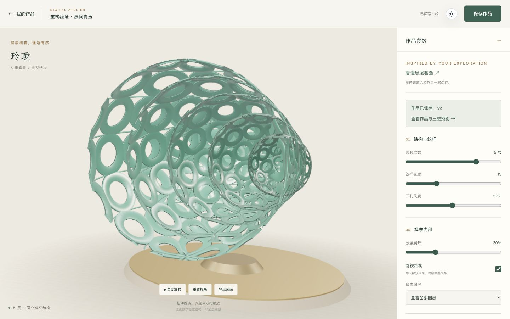

# 工程重构 · 2026-10-21

> 执行：使用 subagent-driven-development，逐项实现、审查和提交；用户已授权自主重构，无阶段确认等待。

**Goal:** 修复测试契约漂移和保存后导航误报，把三维捕获、球层规格和全局外观从不相干的职责中分离。
**Architecture:** 保留 Vue/Three.js/Express/SQLite 和现有持久化协议。页面负责组合，文档负责保存状态，捕获模块负责临时渲染，底层模型规格只定义一次。使用小型函数接口，不引入通用 DI/Repository 框架。
**Tech Stack:** Vue 3、TypeScript、Three.js、Node >=22.13、node:test、SQLite。
**Spec:** [审查证据](ENGINEERING_REVIEW_20261021.md)及下方设计；用户最新授权允许替换原实现。

起点 `07ba1b9fedc7cd5b88039d27c8dc919af84b733f`；开始 2026-10-21 15:01:32 SGT。
继续使用 `upgrade/culture-creation-20261021` 独立工作区；原目录、课程历史和个人数据库保留。

## Global Constraints

- Node >=22.13；不增加付费服务、账号或运行时依赖，不合并默认分支、不强推。
- 保持配置 v1、SQLite v3、旧请求摘要与旧 journal 快照的兼容；本轮不改数据库 schema。
- 测试不得用 any、ts-ignore、放宽 strict 或删除有效断言制造通过；刻意的旧协议夹具单独保留。
- 同一创作舞台继续只有一个 WebGLRenderer/上下文；捕获已确认配置，成功或失败后不改变用户场景，并正确释放临时 GPU 资源。
- 不继续逐层创作、分享、商城等新业务。重构以更清楚的职责和可验证行为为目的，不按固定行数拆文件。
- 实现代理不能启动子代理，不推送；主代理审查和确认后正常推送当前开发分支。

## 设计选择

选择模块重构：保留有用的状态机和渲染算法，重写其边界。只修类型和 try/catch 会留下三维测试耦合；替换整套技术栈则没有对应收益。

四个可独立验证的增量按序执行。事务命令边界暂缓：现有路由已在事务内调用，且本轮没有新增调用入口；不为将来的未知用例铺框架。类型引用环可随稳定 ID 规格归一一并解除。

## Task 1: 测试类型门禁与完整夹具

**Files:** 新增 `tsconfig.tests.json`、`tests/helpers/work.ts`；修改 package.json、CI、五个存在类型诊断的测试文件。其他测试仅在确有同类通用 Work 夹具时复用。
**Interfaces:** 新增 `makeWork(overrides?: Partial<Work>): Work`，每次返回独立的完整 Work 和 config；`npm run typecheck:tests` 执行测试 noEmit，`npm run typecheck` 同时执行前端、后端及测试检查。保持测试原有运行入口。

- [x] 先运行审计的 strict noEmit 命令，确认当前 36 条诊断（RED），保存失败输出。
- [x] 新配置覆盖 `tests/**/*.ts` 与 `server/tests/**/*.ts`，使用 ES2023、DOM、ESNext/Bundler、strict、skipLibCheck、node types、noEmit；不增加构建产物。
- [x] 修正 HTTP fixture 的 RequestListener 签名、维护操作回调参数和 Three.js 类型收窄；通用 Work 使用完整 fixture。不要改刻意缺字段的旧 journal/pending 协议测试。
- [x] 运行 `npm run typecheck`、`npm test`，确认所有基线行为仍通过；检查 CI 已实际调用包含 tests 的命令，然后提交。

## Task 2: 保存确认、导航与工坊控件职责

**Files:** `src/composables/useAtelierDocument.ts`、`src/views/AtelierView.vue`、`src/views/hub/WorkDetailView.vue`、`tests/editor-lifecycle.test.ts`；新增 `src/components/atelier/AtelierParameters.vue`、`src/lib/atelierNavigation.ts` 和聚焦路由适配测试 `tests/atelier-navigation.test.ts`。
**Interfaces:** 文档新增 `navigationError: Ref<string>` 和 `retryNavigation(): Promise<void>`。保存成功不受导航失败影响；导航重试只执行 replaceWorkId，不重复 HTTP 写入。AtelierParameters 仅通过 `v-model` 接收/更新 DesignConfig，不访问路由、账号、草稿或网络。

- [x] 先补行为测试：真实 composable 配成功 request 和拒绝导航，期望 work/baseline 保持确认、saveState=saved、saveError 为空、导航错误独立存在；原实现应断言失败（RED）。
- [x] 分离确认后的导航异常，保留代次/销毁保护、未确认请求与期间编辑语义；导航重试不调用 request。load/切换文档清掉旧导航提示，销毁后迟到导航结果不改状态。
- [x] 页面导航适配器检查 Vue Router 返回的导航失败；重复到达同一地址视为已到达，取消/阻止则进入独立导航提示，不被当成数据库写入失败。
- [x] 为导航重试与迟到结果补必要行为场景；不要为每个变量写镜像测试。
- [x] 提取结构/观察/材质控件到 AtelierParameters，通过复制配置再发出更新保持单向数据流，保留父级 fieldset 的恢复禁用行为和同步 dirty 跟踪；父页保留文档信息和业务状态组合。
- [x] 格式化本任务触及的两个活动视图，避免职责块压成超长单行；不全仓格式化。页面显示独立导航提示、重试与已保存作品链接。
- [x] 运行文档生命周期相关测试、`npm run typecheck`、全量测试，提交；最终浏览器验证由主代理集成执行。

## Task 3: 三维捕获模块与球层规格归一

**Files:** `src/three/AtelierStage.ts`、`preview.ts`、`ornament.ts`、`layout.ts`、`tests/preview-render.test.ts`、`tests/ornament.test.ts`；新增 `src/three/previewCapture.ts`、必要的小型 `src/three/layerSpec.ts`；如解除类型环，新增共享模板 ID 模块并保持 design 的旧导出兼容。
**Interfaces:** Stage 的 `exportPreview(config: DesignConfig): string | undefined` 对外不变，内部委托 `captureWorkPreview`。新捕获函数接受明确的场景/相机/模型上下文及必要的 GPU/编码边界；接口只暴露捕获需要的能力，不传整个 Stage，也不通过类型强转假造完整 Stage/WebGLRenderer。

- [x] 先建立/迁移对捕获公共接口的行为检查（RED）：成功与 GPU 失败均恢复背景、视口、目标、裁切、可见性；新旧拓扑捕获正确配置；临时资源释放，不释放借用的实时几何。
- [x] 将捕获流水线从 Stage 移出。Stage 保留舞台生命周期、交互和动画；捕获模块可直接通过 typed context 测试，不使用 Object.create(Stage.prototype) 或注入私有字段。
- [x] 将球层半径、材质和固定旋转等实际重复规格归一，实时模型、预览与取景均消费同一规格；保持现有视觉、4:3 PNG、尺寸/体积预算、透明/HDR 合成与同版本重生成行为。
- [x] 保留必要的 GPU 状态和资源所有权断言；取消只绑定私有字段名字的断言，确保其保护的用户行为仍受验证。编码与 GPU 边界允许专用测试替身，不模拟业务成功。
- [x] 运行三维/预览测试、`npm run typecheck`、全量测试和生产构建；提交并报告具体接口与资源所有权。最后由主代理做实际 WebGL/保存/重开验证。

## Task 4: 全局偏好与课程状态解耦

**Files:** 新增 `src/stores/preferences.ts`；修改 `src/stores/app.ts`、main、App、theme/syncThemeDom、ThemeToggle、活动首页/导览/编辑/详情中仅为主题调用 app store 的地方；新增 `tests/preferences.test.ts`。
**Interfaces:** `usePreferencesStore` 提供 theme、locale、initTheme/toggleTheme/setTheme 与 locale 的现有行为，不依赖课程 content 或页面。旧 useAppStore 委托同一偏好状态，保留课程调用接口；既有 theme 存储键继续可读。

同时将模板标识 schema/type 下沉到 `shared/templateId.ts`，由 design 兼容重导出；inspirations 直接依赖该基础模块，移除两者的类型循环。保持全部公开类型、请求 schema 与 JSON 格式不变，不引入新的领域层框架。

- [x] 先为真实偏好状态和旧 store 委托写少量行为检查（RED）：持久化主题读取/切换、无已存偏好时系统主题、旧设置与新页面共享同一主题；mock 仅限 Storage/matchMedia 的浏览器边界。
- [x] 活动入口不再为主题加载整份课程状态；ThemeToggle 标签依据独立 locale/小型文案，不导入课程 content。保持中英文课程设置可用，不扩展翻译系统。
- [x] 运行聚焦测试、`npm run typecheck`、全量测试、生产构建，提交；主代理检查桌面/移动主题和页面流程。

## 集成、审查与交付

- 每项通过独立审查后提交推送，核对远端 SHA；最后整轮审查针对 `07ba1b9..最终提交`。
- 全量类型检查必须包含 tests；执行测试、生产构建、独立数据库 SIGTERM/SIGKILL 重启验证，最低支持 Node 22 再检查一次。
- 浏览器实际验证桌面/移动参数编辑、保存、PNG、重开、导览带入、主题切换；记录控制台与图片结果，保存关键截图。导航异常由故障注入行为测试证明，不修改用户运行环境来造错。
- 在本文追加真实检查点、结果和取舍；README 更新验证命令与架构入口；保留审计时的历史失败事实，补充已解决状态。

## 检查点与证据

| 增量 | 提交 | 实现与验证 |
| --- | --- | --- |
| 测试契约 | `b0ccc50` | 先复现 36 条 strict 诊断；完整 Work 夹具、真实回调签名和测试 noEmit 接入 CI；207 项运行检查与全部类型检查通过 |
| 文档与控件 | `18733c7`、`3a7f4a6` | 保存确认与导航错误分离，导航重试不重发 HTTP；真实 memory-router 测试，参数组件只处理配置；219 项通过 |
| 预览与球层规格 | `c84ffe2` | 公开捕获接口替代私有 Stage 测试拼装；GPU 失败后逐项恢复、临时资源释放；实时/预览统一规格；241 项与类型/生产构建通过 |
| 偏好与依赖 | `5b0c093` | 新旧 store 共享真实引用，活动入口不为主题加载课程状态；模板 ID 下沉解除类型环；5 项真实 Pinia 行为检查、246 项全量检查与生产构建通过 |

`18733c7` 的生产构建实际失败：排版后 Vue 模板内多语句事件失去分号，vue-tsc 未发现而 Vite 拒绝。`3a7f4a6` 改成具名处理函数，生产构建和独立复审通过；对应失败 CI 保留，后续普通修复提交 CI 已绿，没有重写历史。

前三项均经过独立规格与质量审查。远端 `c84ffe243053635e0f724285a4b4c08a3228a70e` 已核实；[该检查点 CI](https://github.com/meilingrl/DigitalGuiGongBall/actions/runs/39563608589) 在 Node 22 上通过。

浏览器使用独立临时 SQLite，从空库初始化及种子开始；`localhost:3012` 与演示站 `127.0.0.1:3011` 分开 Cookie。实际走通导览调参→登录返回→修改参数→保存→详情，得到 v1 作品和 160294 字节的真实 PNG。移动视口检查减少层数时聚焦归一，以及设备草稿显式恢复；恢复前 11 个参数控件全部禁用，恢复与回到已确认基线后状态正确。原演示库未加入这些测试作品。

原生 WebGL 重生成相同已保存配置：重构前后 480×360 PNG 的像素差为零，浅色角点 RGBA 为 `(238,234,224,255)`。这是一个配置与同一浏览器环境下的回归样本，不代表所有配置视觉等价或性能提升。实时剖视、拖动后再次捕获成功，作品仍为 v1，控制台无 error/warn。

## 取舍与恢复

- 保留独立升级工作区与原目录，用户已有数据不覆盖。演示库升级前一致性快照为忽略目录内的 `backups/pre-refactor-20261021.sqlite`，954368 字节，SHA-256 `a742dd30c063b554cdb76cfc25db800e6219bbe1ec4064a76ff78ff2c84bfcb1`。
- 只为确实不同的异常边界增加小型导航适配器；Vue Router 的失败可能以返回值而非抛错表示，真实 memory-router 检查保护此契约。
- 保留当前受事务保护的唯一路由调用方式，暂缓事务命令框架。新增 CLI/组合调用时再明确事务所有权；现在抽象只会增加维护面。
- 生产构建纳入每个 UI 检查点，避免仅类型检查通过就推送可演示结论。
- 预览测试替换 GPU 与编码边界，不证明原生 shader；浏览器样本补充这一证据。未建立第二个 WebGL 上下文。
- 现有故障注入测试会打印预期 API 错误，Vite 仍提示三维块超过 500KB；二者均保留真实输出，没有降低门禁或隐藏告警。

本轮没有数据库迁移，仍为配置 v1 / SQLite v3。只比较重构前后，可在独立工作区检出 `07ba1b9`；撤销已推送改动使用按依赖逆序的 `git revert`，不用强推或 hard reset。更早产品版本与课程版本的恢复方法见 [项目说明](PROJECT_GUIDE.md#恢复回滚与下一步)。

## 最终验证与交接

全部四项已完成；`07ba1b9..5b0c093` 的最终独立审查未发现重要或需处理的轻微问题。源代码稳定检查点为 `5b0c0937c8c93d7d3f7eaf2bb8be5e2db7e81543`，远端同 SHA 已核对，[Node 22 CI 通过](https://github.com/meilingrl/DigitalGuiGongBall/actions/runs/39601466819)。收尾文档提交可由 `git log -1` 查看，未自动合并默认分支。

| 检查 | 实际结果 |
| --- | --- |
| `npm run typecheck` | 前端、后端、strict 测试全部通过；Node 26.4.0 与 22.13.1 均执行 |
| `npm test` | 两个 Node 版本均 246/246，无跳过/取消；包括真实 HTTP/临时库、归属权限、非法输入及旧协议兼容 |
| `npm run build:all` | 最低版本 Node 22.13.1 前后端构建通过；保留原三维大包提示 |
| `npm run test:restart` | Node 22 编译后 HTTP 服务，从空库注册、写入/修改、图片、SIGTERM/SIGKILL、重放、复制/回收/恢复、重登与账号漂移检查通过 |
| 生产源码 import 检查 | 一次性 AST/Vue script 分析 91 个非测试文件、228 条本地静态/字面量动态依赖；运行时与类型均无环，未发现 shared/server/src 的约定反向依赖；不声称完整构建器解析证明 |
| 浏览器 | IAB 真正加载 WebGL；最终 1440×900 桌面与 390×844 移动视口无横向溢出；调参、保存 v2、刷新恢复、服务重启后读取、明暗主题刷新保留均通过；控制台 error/warn 为空 |
| 最终持久化 | QA 作品真实记录为 5 层、青玉、展开 30%、剖视、全部图层，v2 / PNG v2、179119 字节，保留导览来源；未触碰演示库作品 |

深色原生 PNG 为 480×360，顶部背景 `(20,28,26,255)`；模型与底座可视，底部像素包含底座，不误当纯背景。相同版本图片可重生成；更新配置后 v2 的图片也实际写入数据库。

[移动视口截图](screenshots/refactor-atelier-mobile.jpg)。截图是代理的有限浏览器检查，未验证真实手机、多浏览器矩阵、长时间 GPU 负载或生产性能。

最终演示服务由新版工作区的最新 `dist/dist-server` 启动，地址 `http://127.0.0.1:3011`，健康接口正常；按 README 的初始化/种子命令即可复现。原目录仍为 `d921ae0` 且工作区干净。QA 临时库与浏览器只用于本轮隔离检查，测试服务收尾停止；不删除正式工作区、演示库与备份。

开始 2026-10-21 15:01:32 SGT；开发与验证收尾 20:46 SGT，实际经过约 5 小时 45 分钟（墙钟时间，不把时间当工作量指标）。最终只剩文档提交、远端核对与临时环境清理。本轮没有新增横向业务；下一轮仍从已记录的候选中只选择一个。

状态：四项实现、逐项与最终审查、集成验证完成。
